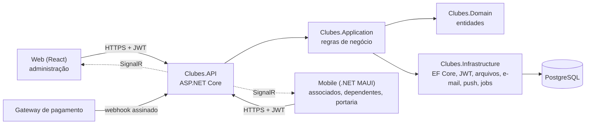

# Arquitetura

## Visão geral

- **Web e Mobile nunca acessam o banco.** Toda comunicação passa pela API, que concentra as regras de negócio.
- **Uma única API** atende os dois clientes; o contrato está em `docs/api/openapi.json`.

## Camadas do backend

| Projeto | Responsabilidade | Depende de |
|---|---|---|
| `Clubes.Domain` | Entidades, enumerações, `DomainException`. Sem dependências externas. | — |
| `Clubes.Application` | Serviços (casos de uso e regras), DTOs, validações, catálogo de permissões, abstrações (`IAppDb`, `ITokenService`, `IFileStorage`, `IEmailSender`, `IPushSender`, `IPaymentGateway`, `IRealtimeNotifier`). | Domain |
| `Clubes.Infrastructure` | `AppDbContext` e migrations, JWT, armazenamento de arquivos, SMTP, Firebase, gateway, rotinas em segundo plano, inicialização do banco. | Application |
| `Clubes.API` | Controllers, middlewares (exceções, contexto da requisição), filtros de permissão, SignalR, Swagger, rate limiting. | Infrastructure |
| `Clubes.Tests` | Testes unitários e de integração. | API |

Injeção de dependência em todas as camadas; os serviços de aplicação (`*Service`) são registrados por convenção. Os controllers são
finos: recebem DTOs validados, chamam o serviço e devolvem DTOs — entidades nunca são expostas.

## Multi-tenancy (isolamento por clube)

Estratégia: banco único, coluna `ClubId` em toda entidade de clube (`ITenantEntity`), com **quatro barreiras independentes**:

1. **Origem do clube**: o `ClubId` vem exclusivamente do token JWT validado (`RequestContextMiddleware`). O que o cliente envia no corpo
   ou na URL nunca define o clube. Apenas o superadministrador pode escolher o clube em que opera (cabeçalho `X-Club-Id`), e o servidor
   confirma que o clube existe; para os demais usuários o cabeçalho é ignorado.
2. **Filtro global de consulta** (EF Core): toda consulta a entidades de clube recebe `WHERE ClubId = <clube do contexto>`. Sem clube no
   contexto, nenhuma linha é devolvida (negação por padrão).
3. **Guarda de gravação** (`SaveChangesAsync`): novos registros recebem o clube do contexto; gravar ou alterar registro de outro clube,
   ou trocar o `ClubId` de um registro, lança erro.
4. **Banco de dados**: relacionamentos entre entidades de clube usam **chave estrangeira composta** `(ClubId, XxxId) → (ClubId, Id)`.
   O PostgreSQL rejeita qualquer vínculo entre registros de clubes diferentes, mesmo que a aplicação falhe.

## Autenticação e autorização

- Login por e-mail e senha (hash PBKDF2 do ASP.NET Identity). Bloqueio temporário após tentativas inválidas; histórico de acessos.
- **Token de acesso** JWT de curta duração (15 min) + **token de renovação** opaco, armazenado apenas como hash, com **rotação** a cada
  uso. Reutilizar um token já rotacionado encerra todas as sessões do usuário (detecção de vazamento).
- Tipos de usuário: superadministrador, administrador do clube, funcionário, associado e dependente.
- **RBAC configurável**: funções por clube são combinações livres do catálogo de permissões; exceções individuais concedem ou negam uma
  permissão a um usuário. As permissões são lidas do banco a cada requisição (mudanças valem imediatamente).
- Endpoints usam `[Permission(...)]` (equipe) com `Self = true` quando associados/dependentes também podem chamar — nesse caso o serviço
  restringe os dados ao próprio usuário. `[Kinds(...)]` restringe por tipo de usuário (ex.: somente associados votam).

## Consistência e concorrência

| Risco | Proteção |
|---|---|
| Conflito de reservas | Restrição `EXCLUDE USING gist` em `ReservationSlot` (espaço + intervalo) — garantida pelo banco |
| QR Code reutilizado / leituras simultâneas | Consumo atômico do token (`UPDATE ... WHERE ConsumedAt IS NULL`) + índice único de presença |
| Pagamento duplicado | Chave de idempotência única por clube + versão de linha (`xmin`) na cobrança |
| Voto duplicado | Índice único `(PollId, MemberId)` |
| Limite de dependentes/convidados/vagas sob concorrência | Bloqueio da linha (`SELECT ... FOR UPDATE`) dentro da transação |
| Mensalidade duplicada | Índice único filtrado por associado + competência |
| Sequências (matrícula, protocolo, recibo) | Contador por clube com `INSERT ... ON CONFLICT DO UPDATE ... RETURNING` |

## Notificações

Os serviços gravam a notificação interna **na mesma transação** da operação de negócio. Um despachante em segundo plano
(`NotificationDispatcher`) entrega depois em tempo real (SignalR), push (Firebase) e e-mail (SMTP), registrando o resultado de cada canal.
Falha de entrega nunca desfaz a operação. Notificações obrigatórias ignoram as preferências do usuário.

## Tempo real

Hub SignalR em `/hubs/clube`. Cada conexão entra no grupo do seu clube e do seu usuário (definidos pelo token). Eventos:
`availabilityChanged` (disponibilidade de espaços), `occupancyChanged` (portaria) e `notification`.

## Rotinas automáticas

`RoutineWorker` executa, para cada clube ativo e em escopo próprio: geração automática de mensalidades (se habilitada), multa e juros,
avisos de vencimento/atraso/bloqueio, política de inadimplência sobre reservas, lembretes de reserva, pendências de devolução de chaves
e limpeza de tokens. Todas são idempotentes.

## Auditoria

O `AppDbContext` gera automaticamente um registro de auditoria para cada criação, alteração e exclusão (usuário, clube, operação,
entidade, valores anteriores e posteriores, origem e justificativa). Gatilhos no banco impedem `UPDATE`, `DELETE` e `TRUNCATE` na
tabela de auditoria.

## Frontend e Mobile

- **Web**: módulos em `src/features/<módulo>` descobertos automaticamente; design system único; tipos gerados do OpenAPI.
  Detalhes em `frontend/clubes-web/README.md`.
- **Mobile**: MVVM (CommunityToolkit), Shell com navegação inferior variável por perfil, credenciais em `SecureStorage`.
  Detalhes em `mobile/README.md`.
