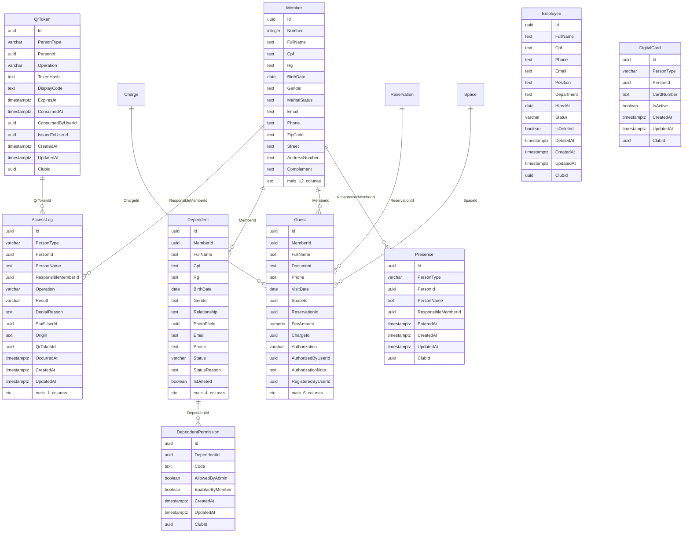
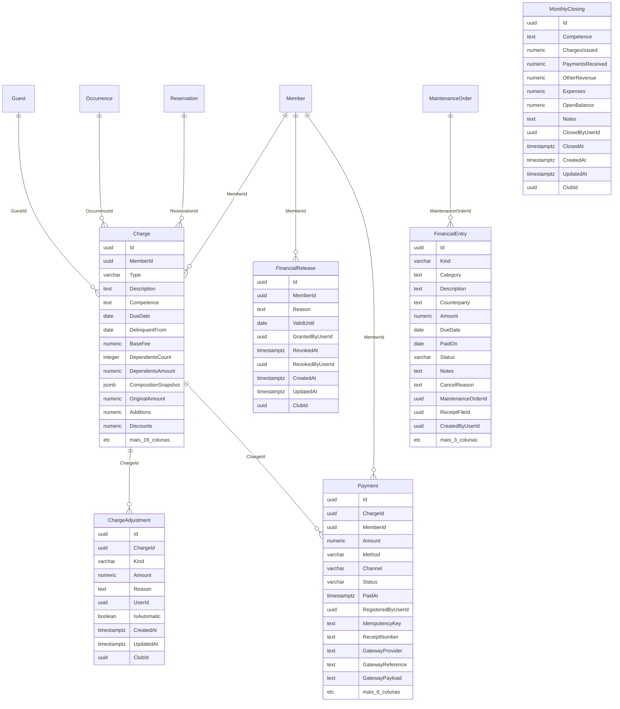
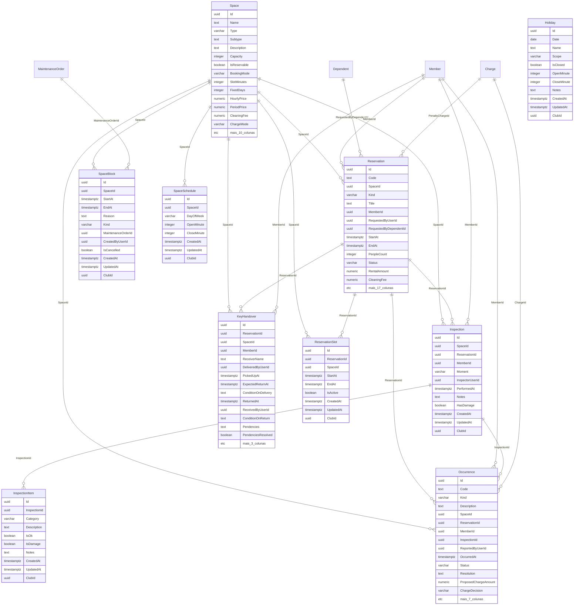
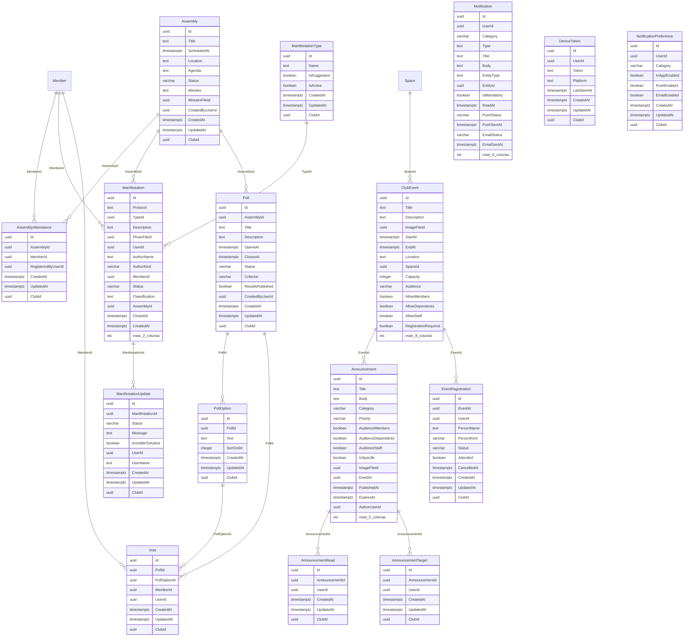
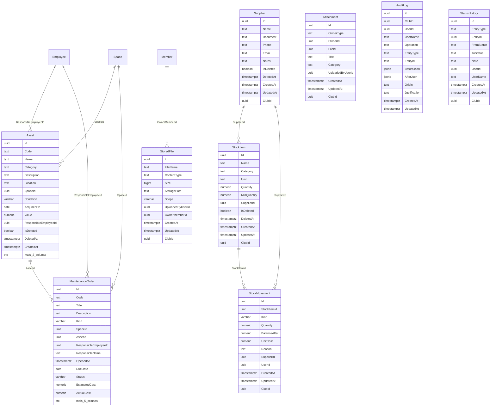

# Diagrama entidade-relacionamento

Gerado a partir do esquema real (`python database/scripts/gerar-doc-banco.py`). Os relacionamentos com `Club` (todas as tabelas de clube possuem `ClubId`) e com `User`/`StoredFile` foram omitidos dos diagramas para manter a leitura; constam no dicionário de dados.

## Plataforma e acesso

```mermaid
erDiagram
    Role ||--o{ RolePermission : "RoleId"
    Dependent ||--o{ User : "DependentId"
    Employee ||--o{ User : "EmployeeId"
    Member ||--o{ User : "MemberId"
    Role ||--o{ UserRole : "RoleId"
    Club {
        uuid Id
        text Name
        text LegalName
        text Cnpj
        text Slug
        text Email
        text Phone
        text ZipCode
        text Street
        text Number
        text Complement
        text District
        text City
        text State
        etc mais_8_colunas
    }
    ClubSettings {
        uuid Id
        numeric MonthlyBaseFee
        integer DueDay
        integer GraceDays
        numeric LateFinePercent
        numeric DailyInterestPercent
        varchar DependentPricingMode
        numeric DependentFixedAmount
        boolean BlockAccessWhenDelinquent
        boolean BlockReservationsWhenDelinquent
        varchar DelinquentReservationPolicy
        boolean AllowAdvancePayment
        text FamilyCompositionChangeRule
        boolean AutoGenerateMonthlyCharges
        etc mais_27_colunas
    }
    ClubOpeningHour {
        uuid Id
        varchar DayOfWeek
        boolean IsClosed
        integer OpenMinute
        integer CloseMinute
        timestamptz CreatedAt
        timestamptz UpdatedAt
        uuid ClubId
    }
    DependentPricingRule {
        uuid Id
        integer FromCount
        integer ToCount
        numeric Amount
        timestamptz CreatedAt
        timestamptz UpdatedAt
        uuid ClubId
    }
    User {
        uuid Id
        uuid ClubId
        text Name
        text Email
        text PasswordHash
        varchar Kind
        uuid MemberId
        uuid DependentId
        uuid EmployeeId
        boolean IsBlocked
        text BlockReason
        boolean MustChangePassword
        integer FailedLoginCount
        timestamptz LockoutUntil
        etc mais_7_colunas
    }
    Role {
        uuid Id
        text Name
        text Description
        boolean IsSystem
        timestamptz CreatedAt
        timestamptz UpdatedAt
        uuid ClubId
    }
    RolePermission {
        uuid Id
        uuid RoleId
        text Permission
        timestamptz CreatedAt
        timestamptz UpdatedAt
        uuid ClubId
    }
    UserRole {
        uuid Id
        uuid UserId
        uuid RoleId
        timestamptz CreatedAt
        timestamptz UpdatedAt
        uuid ClubId
    }
    UserPermission {
        uuid Id
        uuid UserId
        text Permission
        boolean Granted
        timestamptz CreatedAt
        timestamptz UpdatedAt
        uuid ClubId
    }
    RefreshToken {
        uuid Id
        uuid UserId
        text TokenHash
        timestamptz ExpiresAt
        timestamptz RevokedAt
        text RevokedReason
        text ReplacedByHash
        text Device
        text Ip
        timestamptz LastUsedAt
        timestamptz CreatedAt
        timestamptz UpdatedAt
    }
    PasswordResetToken {
        uuid Id
        uuid UserId
        text TokenHash
        timestamptz ExpiresAt
        timestamptz UsedAt
        timestamptz CreatedAt
        timestamptz UpdatedAt
    }
    LoginHistory {
        uuid Id
        uuid ClubId
        uuid UserId
        text Email
        boolean Success
        text Reason
        text Ip
        text UserAgent
        timestamptz CreatedAt
        timestamptz UpdatedAt
    }
    ClubSequence {
        uuid ClubId
        text Name
        bigint Value
    }
```

## Pessoas e portaria

## Financeiro

## Espaços e reservas

## Comunicação

## Operação e auditoria

