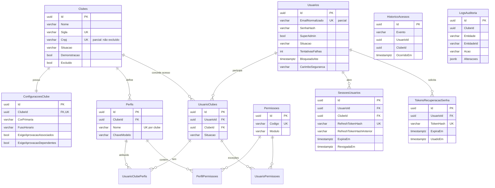
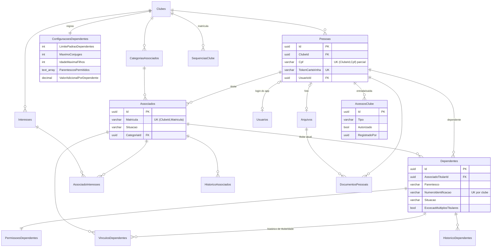
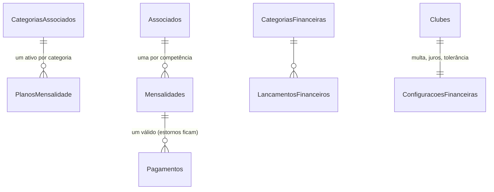
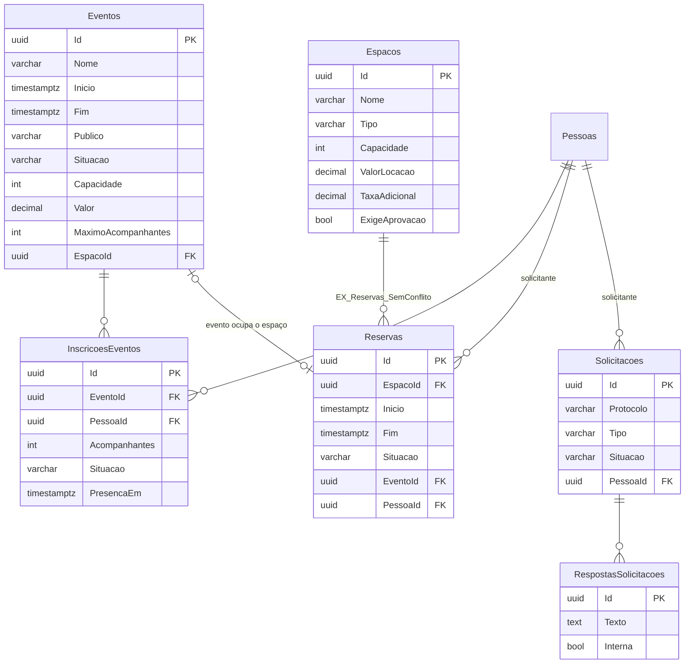
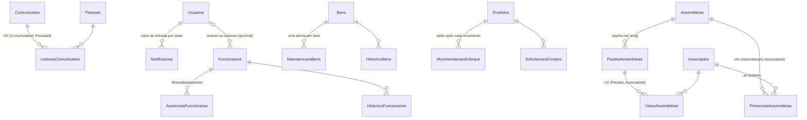

# Diagrama entidade-relacionamento

## Etapa 1 — implementado

## Etapa 2 — implementado

Índices de regra de negócio:
- `UX_Associados_PessoaVigente (ClubeId, PessoaId) WHERE vigente` — um cadastro vigente por pessoa.
- `UX_Dependentes_PessoaVigente (ClubeId, PessoaId) WHERE vigente AND NOT ExcecaoMultiplosTitulares`.
- `UX_Dependentes_TitularPessoaVigente (AssociadoTitularId, PessoaId) WHERE vigente`.

## Etapa 3 — financeiro

## Etapa 4 — eventos, espaços, reservas e solicitações

- `EX_Reservas_SemConflito`: `EXCLUDE USING gist ("EspacoId" WITH =, tstzrange("Inicio","Fim",'[)') WITH &&) WHERE Situacao IN ('Pendente','Aprovada')`.
- `UX_Inscricoes_PessoaEvento (EventoId, PessoaId) WHERE inscrição ativa`.

## Etapa 7 — comunicação, operacional e assembleias

- `CK_Produtos_SaldoNaoNegativo ("Quantidade" >= 0)`, `CK_Movimentacoes_Saldo`, `CK_Votos_Opcao`, `CK_Ausencias_Periodo`, `CK_Manutencoes_*`.
- `UX_Funcionarios_ClubeCpf` (parcial: CPF informado e não excluído), `UX_Bens_ClubeCodigo`, `UX_Produtos_ClubeNome`.
